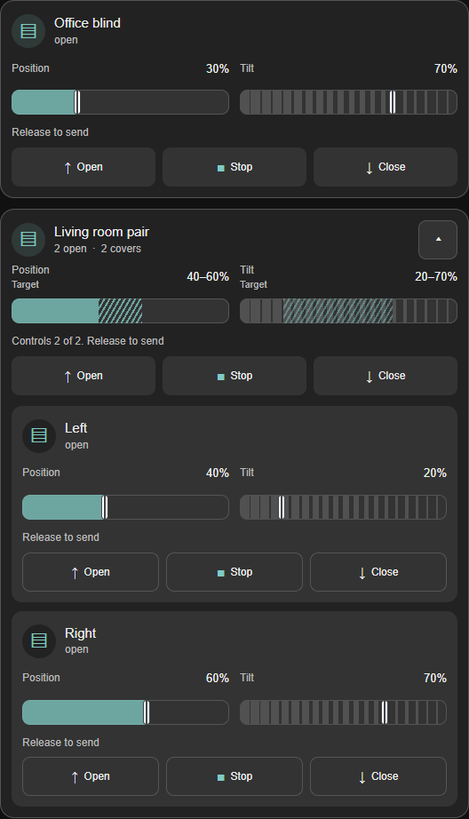
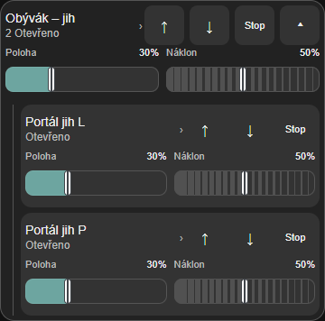
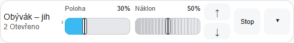

# Advanced Blind Card

A Home Assistant dashboard card for blind position and slat tilt, with inline
sliders, small stacked slats, expandable groups and supported STOP controls.
Group readings show ranges and uncertainty. Loading or expanding the card never
synchronizes motors.

**Latest published beta: [0.1.0-beta.8](https://github.com/pekur/advanced-blind-card/releases/tag/v0.1.0-beta.8).**
Beta 8 adds direct mobile arrows and a narrower desktop name column. Beta 7 added
tolerance-based progress for position and tilt; initial owner-operated Overkiz
checks have been completed. Other real-world configurations remain unverified.
The default layout remains `detailed`.
See [verification and limits](#verification-and-limits) before using it with devices.



Example from the actual card bundle with simulated entities and generic names.

## Configuration

```yaml
type: custom:advanced-blind-card
show_buttons: true
blinds:
  - entity: cover.example
    name: Office blind
  - name: Living room pair
    entities:
      - entity: cover.living_left
        name: Left
      - entity: cover.living_right
        name: Right
    expandable: true
```

`blinds` requires at least one row, in display order. Each row uses either `entity`
or `entities`, never both. A group needs at least two members, each using `entity`
and optional `name`; nested groups are not supported. Every entity ID may occur
only once within a card. A missing entity is shown as a runtime problem.

`name` is optional; individual motors fall back to the Home Assistant entity name.
Unnamed groups show their member count. `show_buttons` defaults to `true` and can
be overridden per row or group member. **`show_buttons: false` hides only
Open / Close; STOP remains visible**, with the same capability and availability
checks.
Groups start collapsed; `expandable` defaults to `true`, and `false`
hides the expansion control. Expansion is local UI state and never moves motors.
The [visual editor](#language-accessibility-and-visual-editor) supports global options;
covers, groups and member overrides use YAML.

Group readings show the actual range (such as 40–60%), plus unknown, unavailable,
or unsupported members. They never substitute an average. Group sliders select an
explicit target; reported values remain visible while previewing. An unknown or
mixed tilt has no invented SVG angle. Releasing a group slider sends the same
target separately to each eligible member. Skipped members and failures are
reported; accepted commands do not prove that a motor physically reached its target.
Expanded member controls affect only that member. Errors remain visible when
collapsed. A group STOP attempts every independently supported stop channel.
There is no retry, rollback, automatic synchronization, or automatic tilt restoration
after STOP. Motor mechanics may change tilt during height travel or stopping.

Position and tilt use Home Assistant percentages from 0 to 100. Slider movement
previews locally; releasing the pointer or a slider key sends one command. Escape
or a cancelled pointer gesture discards the preview. Incoming state updates do not
interrupt an active edit. A keyboard edit also commits on focus loss.
Switching away from the page or losing pointer capture discards an active drag.

The compact SVG is no taller than a range control and stacks the slats vertically,
each tilting around its own center. By default,
it shows vertical slats at 0% and horizontal slats at 100%. This is an
illustration, not a measured physical angle; service values are never inverted.
Unknown values are labeled and cannot send slider commands. Actions require the
entity's matching capability, an available service, and a connected Home Assistant.
STOP independently invokes supported lift-stop and tilt-stop services and remains
available while movement requests await a response. Errors are shown in the card.
Rendering, initialization, and state updates never command a motor.

## Command progress

Position and tilt retain the last sent target separately from the HA-reported
reading. Status distinguishes sending, waiting for state, HA-reported movement,
an exactly reported target, a near result, interruption, and uncertainty. Service
acceptance does not confirm physical completion. An initially matching value is
labelled as already reported; subsequent external changes make completed results
historical. Group progress counts members separately, including skipped, failed,
and individually replaced targets. Mixed readings remain ranges.
Collapsed groups also show current individual targets and their live results,
separately from the last common target. An individual target never becomes an
implied common target for the group.

In beta 7, a fresh relevant HA reading within two percentage points
of the target is labelled **near**. Once the service accepts the command and the
reading and state remain stable for two seconds without HA reporting movement,
it is marked **within tolerance**. The actual HA value remains visible. This is
an estimate based on HA data, not proof that the motor physically stopped.
After 120 seconds without confirmation, the result is unconfirmed; this UI deadline
does not release pending service requests or send any command. Later HA data can
clarify the result. STOP interrupts tracked goals and reports service responses
without claiming physical rest. A cover's opening/closing state does not prove
tilt movement. No travel time or physical progress percentage is estimated.

New progress messages follow the HA language (Czech or English, English fallback)
and movement indicators respect reduced-motion preferences. Tracking is local to
the current card instance and is cleared on configuration replacement or removal.

## Visual and display settings

The following options inherit **card → row → group member**. A child overrides
only explicitly supplied fields. Names, entity IDs, and `expandable` do not inherit.

| Option                  | Default                                | Effect                                           |
| ----------------------- | -------------------------------------- | ------------------------------------------------ |
| `tilt_visual.mode`      | `single`                               | Preset: `single` or `bidirectional`              |
| `tilt_visual.min_angle` | `-90`                                  | Minimum illustrative angle, from `-90` to `90`   |
| `tilt_visual.max_angle` | `0` for single, `90` for bidirectional | Maximum angle; must exceed the minimum           |
| `tilt_visual.invert`    | `false`                                | Reverse SVG mapping only                         |
| `show_buttons`          | `true`                                 | Show Open / Close; STOP remains                  |
| `show_name`             | `true`                                 | Show the heading name                            |
| `show_state`            | `true`                                 | Show the ordinary idle state                     |
| `show_values`           | `true`                                 | Show ordinary idle percentage labels             |
| `layout`                | `detailed`                             | `detailed` or `inline`; inherits to rows/members |

Angles use **0° = horizontal** and ±90° = vertical. The default single range
−90°→0° preserves the earlier illustration. Bidirectional −90°→90° is horizontal
at 50% and vertical at both ends. Custom ranges map linearly; inversion reverses
the visual input. **HA percentages, slider steps and outgoing commands never invert.**

Merge explicit visual fields before filling preset defaults. An explicit parent
bound stays inherited even when a child changes mode. To let a child use its full
preset, omit parent bounds or override them at the child. Every level must be valid;
a child cannot repair invalid parent settings. Nulls, alternative option names and coerced types
are rejected; `tilt_visual: {}` simply inherits.

```yaml
type: custom:advanced-blind-card
show_buttons: false
tilt_visual:
  mode: single
blinds:
  - entity: cover.office
    show_values: false
  - name: Living room pair
    tilt_visual:
      mode: bidirectional
    entities:
      - entity: cover.living_left
      - entity: cover.living_right
        tilt_visual:
          invert: true
        show_buttons: true
```

In this example STOP remains everywhere; the right member also shows Open / Close.
The two member maps differ, so their shared SVG is indeterminate even if their
reported percentages match. Member previews use their own maps. Equal effective
maps can share a preview even if their preset names differ. Mixed or unknown data
still use ranges or uncertainty, without an averaged or invented angle.

Hiding names preserves accessible names and member identification in results/errors.
Hiding state or values never suppresses movement, mixed/unknown readings, errors,
previews, unresolved goals or the numeric context in progress panels. STOP remains
available during a pending movement request.

## Slider steps

Both sliders now default to **10 percentage points**, including configurations
without step options. To keep the earlier fine-grained selection, set both to `1`.
Configure the axes independently:

```yaml
position_step: 10
tilt_step: 10
```

Allowed numeric steps are `1`, `2`, `4`, `5`, `10`, `20`, `25`, `50`, and `100`.
They divide the full range so both 0 and 100 remain selectable. These options
inherit from the card to a row and then to a member. The visual editor changes
the two global options; choose Default to remove an explicit global value.
Set row/member overrides in YAML.

A group slider chooses one target using the group's step and sends that same
target to every eligible member. A member's step applies to its own slider.
Reported values, ranges, slat illustrations and progress retain exact HA values:
9% stays 9%. The native slider thumb can rest on the nearest grid value while
its text and accessible report remain exact. A first arrow-key edit selects
the adjacent grid target (for example, 9 → 10 when increasing with step 10).
Home and End choose 0 and 100. Commands still wait for interaction completion;
loading, changing steps and state updates never send commands. Progress tolerances
are independent of the step size.


## Layouts

The default `layout: detailed` preserves the existing tile layout. The optional
`layout: inline` keeps both sliders, supported STOP and Open / Close controls
in one row when space permits. On narrow cards the sliders move below the
heading. The group arrow expands directly to members, whose layout inherits from
the group unless explicitly overridden.

The inline position bar is filled. Since **beta 6**, the tilt bar uses a fixed
graduated lamella scale based on the configured angle and inversion. Mixed or
incomplete group readings are also shown in full below the row; unknown readings
or incompatible mappings do not invent a common angle. Targets appear above the
bar, without text covering the track. Settled successful results return the row
to its ordinary state; full details remain available from the heading. In the
beta 7, a tolerance result that later becomes historical is visible
again. Pending responses, failures and unconfirmed results remain visible.
The native slider gestures and default detailed layout are
preserved, including RTL direction and release-only dispatch. Select the heading
to open the full detail; opening it cancels unfinished slider previews without
sending them. Step settings do not round HA reports. Beta 7 has had initial
owner-operated Overkiz checks; other integrations remain unverified.

```yaml
type: custom:advanced-blind-card
layout: inline
blinds:
  - name: Living room pair
    entities:
      - entity: cover.living_left
      - entity: cover.living_right
        layout: detailed
  - entity: cover.office
```

In beta 8, `show_buttons: true` shows direct **↑ / ↓**
buttons at all widths: side by side at 430 px or narrower, stacked above that.
Mobile arrows and STOP have 44 × 44 px targets; the stacked desktop arrows are
44 × 28 px. The name column is narrower on desktop to leave more space for sliders.
With `show_buttons: false`, arrows are hidden while STOP remains directly accessible,
including while a movement response is pending. Expanding a group sends no command;
direct arrows cancel an unfinished slider preview before sending their own command.
Beta 7 used a **⋮** menu on narrow cards. No YAML change is needed.

Inline layout, rendered with simulated Home Assistant entities:

| Phone, dark theme                                                                             | Desktop, light theme                                                                         |
| --------------------------------------------------------------------------------------------- | -------------------------------------------------------------------------------------------- |
|  |  |

Six ordinary collapsed rows measure 462 px high at 490 px wide in the local
mock-browser fixture. Expanded members, long names, errors, motion and unresolved
targets can increase the height. Important readings and results remain visible;
ordinary idle gesture instructions stay available to assistive technology.
The owner confirmed passive use of the earlier inline layout and supplied HA
screenshots of responsive arrows. The owner also independently reported working
arrows and STOP. These observations do not verify beta 5; the evidence below
distinguishes owner observations from local verification.

### Detailed tile layout

The position and tilt controls sit side by side, switching to a single column
in a narrow card. Small stacked slats sit beside the tilt value. Expanded members
use a separate background, and supported STOP remains available with Open / Close
hidden. This layout uses the existing configuration options.

An incomplete group reading shows a compact range with `+ ?`; the full uncertainty
and eligibility explanations remain below the sliders. During interaction, the
preview target and reported values appear below the controls. Progress for each
axis spans the row and retains individual member results when the group is collapsed.


## Language, accessibility and visual editor

The card and editor use Czech for `hass.language` values such as `cs` or `cs-CZ`,
and English for other languages. Entity names and states use Home Assistant's
public formatters when available. Custom names and errors returned by HA services
are preserved. Language changes do not send commands or reset an active gesture.

Sliders support native keyboard interaction; release the key or finish interaction
to send, and use Escape to cancel. Group controls distinguish a chosen target from
reported ranges. Numeric outputs have live announcements disabled; progress
changes use polite announcements. Names remain accessible when headings are hidden,
and expansion retains focus on its button. Actual screen-reader support remains
unverified; browser checks alone do not establish assistive-technology compatibility.

The visual editor for an existing card changes only global `layout`, `show_buttons`,
`show_name`, `show_state`, `show_values`, `position_step`, `tilt_step`, and
`tilt_visual` options. Edit `blinds`,
groups and member overrides in YAML. Their configuration and dashboard layout and
visibility metadata are preserved when global options change. Row/member overrides
still take precedence. There is no automatic entity selection or card-picker setup.

Select **Default** to remove a global override; empty angle fields remove explicit
bounds. Display flags default to true, `mode` to `single`, and `invert` to false.
Changing mode preserves explicit angles and otherwise uses that mode's bounds.
Invalid or incomplete numbers remain local until the complete configuration is
valid. Unsupported source YAML is reported for correction in YAML, without repair
or removal of its fields. Loading, rendering, validation and passive preview
updates never send motor commands.

## Installation and updates

For a manual installation, [build the card](#development) from source or
download `advanced-blind-card.js` from the
[beta 8 release](https://github.com/pekur/advanced-blind-card/releases/tag/v0.1.0-beta.8).
Copy the JS into `www/` within your
Home Assistant configuration directory. This is a dashboard resource, not a
`custom_components` integration.
Register one **JavaScript module** dashboard resource:

```text
/local/advanced-blind-card.js?v=0.1.0-beta.8
```

Add a manual card using the [configuration above](#configuration), replacing the
example entity IDs. On update, replace the JS file and change the existing
resource's query suffix to the new version or build hash, then fully reload the
dashboard (for example Ctrl+F5 on desktop). Keep one active resource for this card.
For an unreleased rebuild, use a new hash suffix even if the version is unchanged.

### HACS installation

Repository: [pekur/advanced-blind-card](https://github.com/pekur/advanced-blind-card).
The first release, **v0.1.0-beta.1**, is an experimental prerelease with one
`advanced-blind-card.js` asset. Add it as a custom repository; inclusion in the
default HACS catalog is not claimed.
Version **v0.1.0-beta.3** added responsive direct arrows. Version
**v0.1.0-beta.5** adds lamella strips and quiet results. Beta 6 uses a graduated
lamella scale; beta 7 adds tolerance-based progress and beta 8 direct mobile arrows.

The version-selection procedure was confirmed for beta 1 with HACS **2.0.5** and
frontend **20250128065759**. In that environment the initial default download
selected a commit. Explicitly selecting the release through the other-version
selector was necessary to make HACS report **v0.1.0-beta.1** as installed.

#### Installation and migration from a manual resource

1. Add the repository URL above to HACS as a **Dashboard** custom repository.
2. Open **Download**, or **Redownload** from the card's HACS menu if already
   installed. Expand the option for a different version and explicitly select
   **v0.1.0-beta.8**. Check that the download dialog names this tag rather than a
   commit. If this beta is not offered, check the release and any HACS error;
   do not substitute a commit.
3. When migrating from a manual installation, save its `/local/` resource URL
   and keep the JS file for rollback. Remove only that resource registration
   before confirming the HACS download.
4. Confirm the download and use the **JavaScript module** resource provided by
   HACS, normally `/hacsfiles/advanced-blind-card/advanced-blind-card.js` with its
   cache query. Before fully reloading, verify that only one resource loads this
   card. Check the installed version in HACS; the resource query is a cache key,
   not a version label.
5. Fully reload the dashboard, then check loading, expansion and the editor
   without moving motors. For later updates, select the intended release in
   HACS and refresh the dashboard cache. Re-downloading the same beta does not
   verify an update between versions.

If migrating from a manual installation and loading fails, disable the HACS
resource, restore the saved manual resource, and reload. Keep only one active
resource. A beta 1 → beta 2 update was owner-confirmed; the beta 5 update and actual
rollback remain unverified. Beta 5 adds no configuration keys; returning to beta 4
needs no YAML changes. When returning from a build with `layout` to beta 1,
restore the saved beta 1 YAML first: remove `layout` at card, row and member level, because beta 1
rejects this option. Keep the existing single resource when changing HACS versions.
See the official
[HACS dashboard requirements](https://www.hacs.dev/docs/publish/plugin/) and
[custom repository instructions](https://www.hacs.dev/docs/faq/custom_repositories/).
The version selector is also visible in the
[tested HACS frontend source](https://github.com/hacs/frontend/blob/20250128065759/src/components/dialogs/hacs-download-dialog.ts).

## Verification and limits

The reviewed lamella implementation passed check/build, 146 Node tests and
266 mock-browser scenarios (21 lamella, 16 RTL, 20 arrows, 35 inline,
164 regressions, two previous review regressions and eight timeout/STOP checks)
in Edge. Independent review found a held-service timeout losing its visible
unconfirmed warning. It was fixed and independently rechecked, with no remaining
findings. The beta 5 bundle differs from that reviewed and committed
implementation only in its version header and includes complete license notices.
The owner confirmed installing beta 2 through HACS, loading without errors or
observed movement, and passive inline menu/expansion use. These are observations,
not a server-file hash or proof of physical command delivery. Earlier motor checks
concern earlier builds. Later owner reports and screenshots show the responsive
arrows in HA, and the owner independently reported working arrows and STOP, without
a captured service trace or server-file hash. Owner screenshots of the filled-slider
build prompted this UX revision; they do not establish a successful beta 5 smoke
test. Beta 5 has only local tests and no real-device verification.

For beta 7, the owner reported a successful passive load and group expansion.
In supervised Overkiz checks, a bedroom tilt target of 10% was reported as 9%
and its waiting highlight cleared without an error; a position target of 10%
was reported as exactly 10%, as was a later position target of 20%. A group tilt
target of 90% was reported as 91% by both members and the waiting highlight
cleared. In a subsequent test, the card showed a mixed starting tilt of 10% and
0%, then 21% for both members after a common target of 20%; the owner reported
the behavior was as expected. These are owner observations and screenshots,
not a server-file hash or a measured two-second timing. Position tolerance,
different group member results and STOP in beta 7 remain unverified on devices.
The local beta 7 candidate passed build, Biome, 153 Node tests and 199 simulated
browser regression scenarios; implementation and distribution reviews were
completed, and the downloaded public JS matched the reviewed artifact.

For beta 8, the owner supplied phone and desktop screenshots in light and dark
themes, including an expanded group, and reported that the controls work well.
These observations do not include a captured service trace or HA server-file hash.
The beta 8 candidate passed build, Biome, 153 Node tests and 178 simulated browser
scenarios; the downloaded public JS matched the independently reviewed artifact.

| Area                                                                           | Evidence and remaining limits                                                                                                                                                                                                                                                                                                    |
| ------------------------------------------------------------------------------ | -------------------------------------------------------------------------------------------------------------------------------------------------------------------------------------------------------------------------------------------------------------------------------------------------------------------------------- |
| Individual/group motor control                                                 | Owner-operated Overkiz checks on earlier functional builds covered position, tilt, STOP, independent/shared commands and different member results.                                                                                                                                                                               |
| Released detailed layout and steps                                             | Independent code reviews and mock browser regressions; owner-operated passive HA checks covered loading/reload, expansion, both themes, editor changes, defaults, YAML key removal and save/reopen without observed movement. New steps have not been physically exercised.                                                      |
| Android                                                                        | Passive HA app check on a Pixel 9 Pro with an Android beta. Exact Android/app/WebView builds and native touch command delivery are unverified.                                                                                                                                                                                   |
| Unsupported tilt, unavailable entities, partial failures, bidirectional motors | Automated capability, dispatch, progress and UI mocks. No suitable real devices were available for these cases. SVG bidirectional mapping does not establish motor compatibility.                                                                                                                                                |
| Accessibility and browsers                                                     | Native keyboard, focus, DOM/SSR, simulated input events, emulated touch and mock theme contrast checked in Edge. Actual screen readers, other browser engines and forced CSS fallbacks are unverified.                                                                                                                           |
| Release artifact                                                               | Public beta 1, 3 and 4 JS assets matched their reviewed builds byte for byte. The beta 5 bundle matches the reviewed implementation except for its version header and includes complete licenses. Compare a downloaded beta 5 asset with the SHA256 in its release notes.                                                        |
| HACS                                                                           | Owner confirmed beta 1 installation, then updating to beta 2 with one resource and passive loading/menu/expansion without errors or observed movement on HACS 2.0.5 / frontend 20250128065759. Earlier beta 1 checks included the editor. HA server-file hash, actual rollback and minimum supported versions remain unverified. |

The earlier owner-reported HA version was 2026.10.2; the later description
"latest HA" did not pin an exact server or app build for the beta 1 HACS check.
For beta 2 the owner reported Core/Supervisor 2026.10.4, OS 18.3 and HA frontend
20260930.5, with HACS 2.0.5 / frontend 20250128065759. Beta 1
underwent independent code and packaging reviews, including verification of fixes,
and was published with maintainer approval of the stated test gaps. Owner reports
are observations, not a server-file hash or a trace of HA service calls. These
checks do not establish compatibility with every motor or HA/HACS version.

## Development

Use Node.js 24 or newer and pnpm 11.25.0.

```sh
pnpm install --frozen-lockfile
pnpm check
pnpm build
pnpm test
```

Run the build before tests. The Node runner tests configuration, capabilities,
command dispatch, gesture cancellation, pending requests, and stale results using
the same TypeScript helpers as the card. It also checks that the browser bundle
parses and has no external runtime dependencies. No DOM emulator, TypeScript loader,
or extra test framework is used. Node tests do not establish browser or device
compatibility; those require separate checks.
The bundle is written to `dist/advanced-blind-card.js`. This single generated file
is tracked for initial HACS repository validation; commit the freshly built bundle
with source changes that affect it. It uses LF line endings to preserve its bytes
across checkouts and is excluded from Biome's source checks. Other generated files
remain ignored. A release asset must match this built file byte for byte.
HACS 2.0.5 filters prereleases by default during repository registration, so the
tracked JS also permits initial structure validation before selecting a beta.
See the pinned [release filtering](https://github.com/hacs/integration/blob/2.0.5/custom_components/hacs/repositories/base.py)
and [JS discovery](https://github.com/hacs/integration/blob/2.0.5/custom_components/hacs/repositories/plugin.py).

TypeScript checks the source, Lit supplies reactive web components, esbuild produces
a single browser ES module with Lit included, and Biome handles linting and
formatting. pnpm is pinned in `package.json`.
No development server or CI is included.

The esbuild dependency's install script is explicitly disabled in
`pnpm-workspace.yaml`. The build uses its platform binary installed through optional
dependencies; no dependency install script needs approval.

Working notes and handoffs belong in the Git-ignored `.codex-handoffs/` directory.

## License

[MIT](LICENSE), copyright 2026 Petr Kurka. The standalone JS includes the complete
project license and BSD-3-Clause notices for its bundled Lit packages. Build
metadata identifies the actual bundled package versions. The package remains
private; this project does not publish an npm package.
